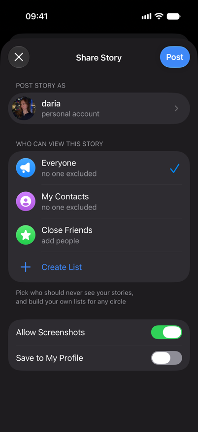
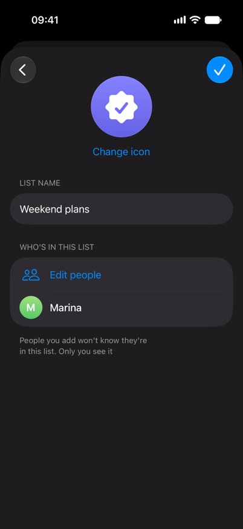
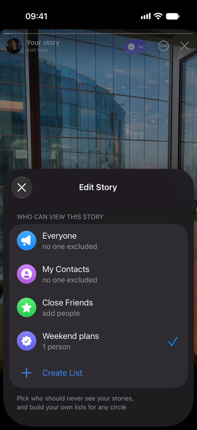

# Story Audiences for Telegram iOS

Reusable story audiences: create a named list, choose an icon, add people, and reuse it when publishing stories. Built with the original Telegram iOS media editor, privacy screen, contact picker, navigation, story viewer and publication animation.

**[Download the offline Simulator demo](https://github.com/drbvrr/Telegram-iOS/releases)** · **[Run from Xcode](build-system/story-audiences-demo/README.md)** · **[Integration notes](docs/story-audiences/INTEGRATION.md)** · **[Patch](story-audiences-delivery/story-audiences-native.patch)**

This is an unofficial feature prototype in a fork of [TelegramMessenger/Telegram-iOS](https://github.com/TelegramMessenger/Telegram-iOS). The demo runs locally with supplied contacts, avatars, chats and stories. It needs no Telegram account, Premium, API keys or connection to Telegram servers.

| Share a story | Edit a list | Change an audience |
| --- | --- | --- |
|  |  |  |

## Try it

The fastest route is the **StoryAudiences-offline-demo-arm64-ios27.2.zip** asset in Releases. Extract the whole archive and run **Launch Story Audiences.command**. Xcode and the iOS 27.2 Simulator runtime must already be installed; the app does not need compiling. Tested on an Apple Silicon Mac with Xcode 27.2 / iOS 27.2.

The generated Xcode project is built from this fork. [Build instructions](build-system/story-audiences-demo/README.md) include a fresh-clone route and a pinned patch route.

Walkthrough: **Next → Create List → select people → Next → name / icon → checkmark → Post → My Story → audience switcher**. The original story viewers screen is retained.

## Behavior

- Everyone, My Contacts and Close Friends remain. Close Friends keeps its green indication; custom membership is private to the author.
- Lists retain names, icons, people and assigned colors across launches. Duplicate names and empty membership are allowed; blank names are rejected.
- Editing a list updates access to linked local stories. Deleting a list moves its linked stories and selection to Everyone.
- Moving a story replaces its audience after confirmation. Its old audience is not retained.
- Member removal, deletion and moving use native confirmation alerts. The selected-avatar strip, list details and icon cloud follow the supplied design.

## Implementation status

The UI and local audience/story behavior work in the original client. Production reuse points include `StoryAudienceStore`, `StoryAudienceConfiguration`, the original privacy/contact screens, the new list editor, and author story badge hooks.

The supplied executable uses an isolated offline account and local privacy adapter. **Live-account wiring, remote privacy enforcement and cross-device list synchronization are not delivered or validated here.** [Integration notes](docs/story-audiences/INTEGRATION.md) identify what a connected client must wire to the existing Telegram engine. The demo bootstrap should remain isolated.

## Review the change

- Upstream base: [`24638bc69bd083981b178dd1e7f921eebbf7fc46`](https://github.com/TelegramMessenger/Telegram-iOS/commit/24638bc69bd083981b178dd1e7f921eebbf7fc46).
- Feature branch: `story-audiences`.
- [Technical integration map](docs/story-audiences/INTEGRATION.md), [verification](docs/story-audiences/VERIFICATION.md), [credits](build-system/story-audiences-demo/NOTICE.md).
- The binary patch includes the demo fixture assets. It applies to the pinned base; applying to a newer upstream revision may require resolving changes.
- Original upstream build instructions are preserved in [UPSTREAM-BUILD.md](docs/story-audiences/UPSTREAM-BUILD.md).

Code submission and design by [drbvrr](https://github.com/drbvrr). Telegram and vendored code retain their original notices. Fixture images and icons were supplied for this prototype.
